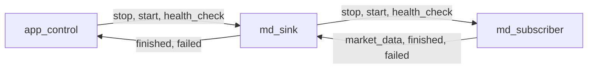

# OKX market-data capture

`okx_md_capture` captures OKX Spot WebSocket messages through `asio_comm`, composes the app
with Assembly/relay, loads JSON config with `json_config`, and writes one ordered capture
stream through `nom::md_logger` from the `nom.services` module. Operational logs contain status and counters, not raw payloads.
It is the current implementation described by the [MD capture reference design](../../../docs/md_capture/md_capture_reference_design.md).

## Build and run

### Manual build and run

From the repository root:

```bash
cmake --workflow --preset dev
mkdir -p data
build/dev/bin/okx_md_capture --config build/dev/config/okx_md_capture/okx_md_capture.json --check-config
build/dev/bin/okx_md_capture --config build/dev/config/okx_md_capture/okx_md_capture.json \
    --set /app_control/exit_after_sec=10
```

### Bootstrap build and validation

`./bootstrap.sh complete` runs application-control and config-ownership tests, both logger unit
suites, generated config validation and a local TLS integration test. Coverage includes capture
output and recovery, heartbeats, transport and storage failures, signals, runtime limits,
append behavior and config defaults/overrides. The `dev` preset skips the TLS integration test.

## Configuration

The [sample config](config/okx_md_capture.json) follows this hierarchy:

```text
app_config
├── log
├── md_subscriber
│   ├── connection
│   │   ├── endpoint
│   │   └── heartbeat_sec
│   └── subscription
│       ├── symbols
│       └── channels
├── md_sink
│   └── md_logger
│       ├── file
│       ├── flush_records
│       └── flush_ms
└── app_control
    ├── exit_after_sec
    └── health_check_period_msec
```

`md_subscriber.subscription.symbols` and `md_sink.md_logger.file` are required.
The tables below show the defaults for the remaining config params.
For configuration discovery, command-line overrides, validation and generation, see the
[json_config introduction](https://github.com/nomisma-labs/json_config/blob/master/docs/json_config/intro.md).

`app_config::validate()` checks each component's config. `config_owner` enforces this validation
before constructing the assembly nodes, including when the assembly is created directly.
`--check-config` performs application-level config validation.

`log` configures operational logging using the shared
[logging configuration](https://github.com/nomisma-labs/nom_core/blob/master/docs/nom_core/README.md#logging-configuration).
Market-data output is configured separately under `md_sink.md_logger`.

### md_subscriber config

`connection` selects the source endpoint and heartbeat timing; `subscription` selects the
instruments and channels to capture. Param names below are relative to `md_subscriber`.

| Param | Default | Meaning and constraints |
| --- | --- | --- |
| `connection.endpoint` | `wss://ws.okx.com/ws/v5/public` | WebSocket endpoint; must use `wss://`. |
| `connection.heartbeat_sec` | `20` | Receive-silence period and heartbeat-response timeout, in seconds; 1..29. |
| `subscription.symbols` | Required | Nonempty list of Spot instrument IDs such as `BTC-USDT`; subscribed in uppercase. Duplicates are rejected after normalization. |
| `subscription.channels` | `["tickers","trades","books"]` | Nonempty subset of `tickers`, `trades` and `books`, without duplicates. |

### md_sink config

The sink's storage config is grouped under `md_logger`. Param names below are relative
to `md_sink`.

| Param | Default | Meaning and constraints |
| --- | --- | --- |
| `md_logger.file` | Required | Capture output file. Relative paths resolve from the process working directory. |
| `md_logger.flush_records` | `16384` | Positive queued-record threshold for waking the writer; a batching trigger, not a buffer capacity limit. |
| `md_logger.flush_ms` | `2000` | Writer wait for a partially filled shared buffer, in milliseconds; 1..60000. Pending-buffer time and file I/O can add further delay. |

### app_control config

This config controls the application's runtime limit and health-check period. Param names
below are relative to `app_control`.

| Param | Default | Meaning and constraints |
| --- | --- | --- |
| `exit_after_sec` | `null` | No runtime limit when absent or null; otherwise 0..86400 seconds from application start, including connection setup. Zero schedules an immediate stop. |
| `health_check_period_msec` | `2000` | Period between application health checks, in milliseconds; 0..60000. Zero disables checks. |

The sink uses the periodic health checks to detect MD writer failures even during feed silence.

## Market data output

Received JSON messages are appended to `md_sink.md_logger.file`. All subscribed symbols and
channels share this file. Parent directories are created on the first write batch, and existing
contents are retained on restart.

Each record is `<timestamp-microseconds><space><JSON-object><LF>`. The timestamp is the local
receive time in microseconds since the Unix epoch. Literal CR/LF bytes in a message become
spaces; other bytes and JSON escapes remain unchanged. Subscription acknowledgements and
exchange error responses are recorded alongside market-data messages.

The writer uses one append-only file without rotation or metadata sidecars. Writes are buffered,
and the logger does not call `fsync`. See the [MD logger guide](../../../docs/md_capture/md_logger.md)
for buffering, write-error handling and durability details.

With the sample config, inspect the output from the repository root:

```bash
cat data/okx_spot.dat
python3 tools/md_capture/read_capture.py data/okx_spot.dat
# Inspect complete records before a malformed or unfinished tail:
python3 tools/md_capture/read_capture.py --recover data/okx_spot.dat
```

## App lifecycle

Startup validates the configuration, initializes operational logging and starts the subscriber.
Connection, transport and reported MD writer failures stop the application.

| Trigger | Behavior |
| --- | --- |
| Ctrl-\ (`SIGQUIT`) | Flush the operational log and continue capturing. The shortcut can be used repeatedly. |
| Ctrl-C (`SIGINT`), runtime limit, explicit stop or completion | Perform normal shutdown; exit 0 if shutdown succeeds. |
| `SIGTERM` | Perform normal shutdown with exit 1, by application convention. |
| Reported component failure | Stop with exit 1, including failures reported during shutdown. |

An operational-log flush leaves MD writer batching unchanged. During shutdown, the subscriber
closes the connection, then the sink drains accepted market data and joins the writer thread.
Remaining I/O callbacks drain before the process exits. A final-write failure changes the exit
status to 1; a recorded failure cannot be replaced by a successful result within the same run.
Startup errors also return exit 1.

Exit status reports application completion. Exchange JSON error messages are stored as received
and do not themselves change that status. See [Application control](../../../docs/md_capture/app_control.md)
for the lifecycle state machine.

## App assembly/relay

[main.cpp](main.cpp) defines the assembly. Its application nodes form this event pipe:



Requests (`app_start`, `app_stop`, `app_health_check`) travel downstream, from left to right.
Responses travel upstream: `md_sink` consumes `market_data` for writing, while `app_control`
consumes `app_finished` and `app_failed`. Delivery between nodes is synchronous on the caller's
thread. The sink copies received data into its private MD logger before returning; file I/O
runs on the logger's writer thread.

The assembly imports `nom.services` for `app_control`, the application events, `md_logger`,
[md_sink](../../../src/services/md_sink.cppm),
[config_owner](../../../src/services/config_owner.cppm), which owns the shared immutable
config, and [asio_service](../../../src/services/asio_service.cppm), which provides the I/O context.
`okx::md_subscriber` is local to this application. See
[Application control](../../../docs/md_capture/app_control.md) for lifecycle events and transitions.
