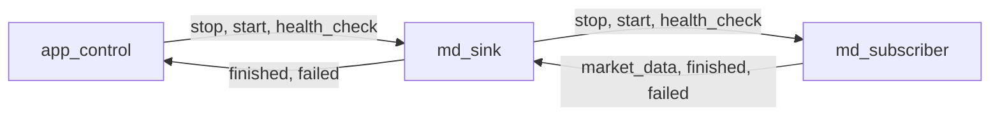
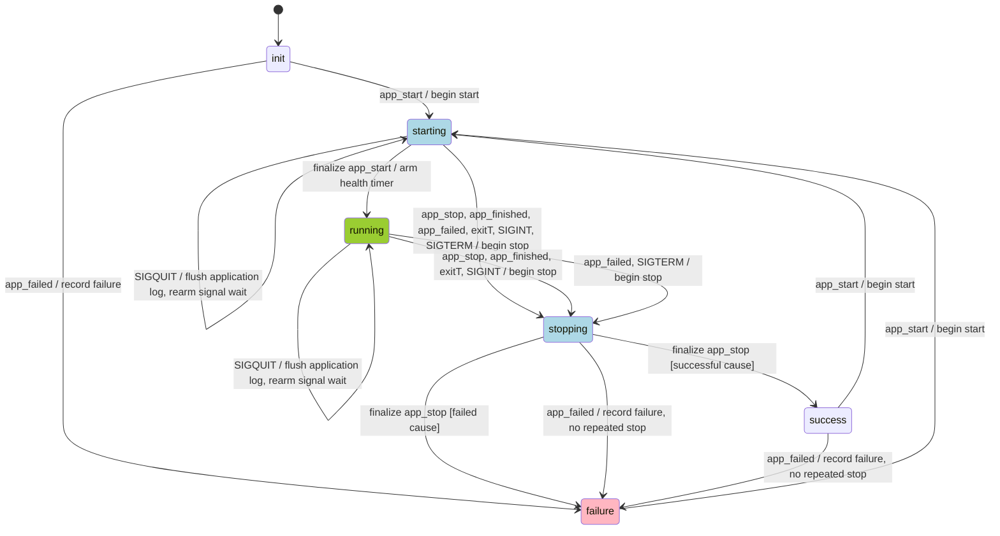

# Application control

Import `nom.services` and link `nom::services` for the shared `config_owner`, `asio_service`,
`app_control` and [md_sink](../../src/services/md_sink.cppm) assembly nodes, application events
and [MD logger](md_logger.md). Their module lives in `src/services/`.
`okx::md_subscriber` remains in the OKX application; `nom.md_logger_ai` is a separate module.

`nom::app_control` coordinates application start and stop, handles console signals, enforces an
optional runtime limit and periodically asks downstream nodes to check their health. Components
report completion through `app_finished` and failure through `app_failed`. The controller
consumes both responses; they do not propagate to upstream nodes. It does not need to know
whether the application captures market data or performs another task.

The controller privately owns `status_`, of type `nom::app_status`. Clients read it through
`ctx().status()`, a const, noexcept accessor; the context does not store a second copy. `starting` and
`stopping` describe synchronous notification in progress, between `init`, `running` and the
terminal results `success`/`failure`. A terminal result allows another run. `main.cpp` explicitly
maps `success` to exit code 0 and other results to 1; enum values are not process exit codes.
See [app_control.cppm](../../src/services/app_control.cppm) for the implementation and
[app_events.cppm](../../src/services/app_events.cppm) for the event types.

## Application event flow (on example of MD capture)

The MD capture nodes form a bidirectional event pipe:

Requests (`app_start`, `app_stop`, `app_health_check`) travel downstream, from left to right.
Responses travel upstream, from right to left: `md_sink` consumes `market_data` messages
for writing, while `app_control` consumes `app_finished` and `app_failed` responses.
Delivery between nodes is synchronous on the caller's thread.

## App control state machine

The tables also cover ignored events and synchronous reentrant delivery. Finalization is a
pseudo-event handled after notification returns, not a queued event or an acknowledgement from
components. Start finalization switches on the current state; stop finalization uses a direct
`if (app_status::stopping == status_)` assignment. Both preserve terminal results selected by
reentrant handlers.

### Events and signals

Application events are in `nom::event`. `exitT`, `healthT` and the two finalization pseudo-events
below label internal processing steps, not event structs.

| Event | Source / handler | Meaning |
| --- | --- | --- |
| `app_start` | Request → `on_request(app_start)` | Begin a run, unless already running or forwarding a lifecycle request. |
| `app_stop` | Request → `on_request(app_stop)` | Request a normal stop. |
| `finalize app_start` | After downstream start delivery → `finalize_app_start()` | Change `starting` to `running`; otherwise preserve the state. |
| `finalize app_stop` | After stop delivery → guarded assignment in the handler | Change `stopping` to the result selected by the initiating event; otherwise preserve the state. |
| `app_finished` | Response → `on_response(app_finished)` | A component reports completion; consume the response and request a normal stop. |
| `app_failed` | Response → `on_response(app_failed)` | A component reports failure; consume the response, record failure and stop an active run. |
| `exitT` | `exit_timer_` → `on_exit_timer()` | The configured runtime has elapsed; request a normal stop. |
| `healthT` | `health_timer_` → `on_health_timer()` | Arm the next tick, then send `app_health_check` downstream. |
| `app_health_check` | Request emitted by `healthT` | Ask participating nodes to check themselves. The controller has no handler for this request. |
| `SIGINT` | Ctrl-C → `on_signal()` | Request a normal stop (`success`). |
| `SIGTERM` | Termination signal → `on_signal()` | Request a stop with `failure`, by application convention. |
| `SIGQUIT` | Ctrl-\ → `on_signal()` | Flush `nom::main_logger`, then wait for another signal; keep running. |

`SIGQUIT` flushes the operational application log. It does not flush the MD writer or call
`fsync`. `SIGTERM` calls `on_response(app_failed{})` to use the failure-stop path; this response
is consumed by `app_control` and does not reach upstream nodes.

The controller reads these parameters from `app_control_config`:

| Parameter | Default | Behavior |
| --- | --- | --- |
| `exit_after_sec` | `null` | No runtime limit when absent/null; otherwise 0..86400 seconds from each accepted start, including start delivery and connection setup. Zero schedules asynchronous expiry immediately. |
| `health_check_period_msec` | `2000` | Period of 0..60000 milliseconds; zero disables health checks. The first check occurs one period after entering `running`. |

The exit timer is armed before start notification, so it covers the complete run. It can stop
the application in either `starting` or `running` when the I/O loop dispatches its callback.
Normally the loop runs after start delivery, so a zero limit stops afterward; if the loop is
serviced during start delivery, the expiry can stop startup itself. Connection events neither
arm nor reset this timer.

Signal waiting is armed when entering `starting`, after advancing the run generation. The
same wait continues into `running`; start finalization does not arm another wait. Signal
callbacks still require the I/O loop to run. In the OKX app, the loop normally runs after
synchronous start delivery, so Ctrl-C received during startup is processed afterward.

The health timer is armed only when start finalization enters `running`.
Health checks run synchronously and should be short. The next tick is armed before forwarding
the check, so a failure during the check cancels that tick as part of shutdown.

### Transition table

The tables use the same **Event / Condition / Next State / Action** format as the
[Active Ping state machine](../../external/asio_comm/docs/asio_comm/web_socket_ping.md#active-ping-state-machine).
**Condition** determines which transition applies when an event is handled in the given state.
A blank condition means unconditional. Timer configuration determines whether an event is
scheduled, not whether its transition applies once delivered: `exitT` and `healthT` do not
recheck whether their timers are enabled. **Next State** is the immediate transition; an
intermediate state can be entered and left within the same handler call.

- **Begin start:** enter `starting`, advance the run generation, arm signal waiting and the
  enabled exit timer, then forward `app_start`. Handle `finalize app_start` using the state left
  by notification; only the health timer is armed when entering `running`.
- **Begin stop:** enter `stopping`, cancel both timers and signal waiting, then forward
  `app_stop` once. After stop delivery, handle `finalize app_stop`: select `success` for normal
  stop/completion, runtime expiry or SIGINT; select `failure` for component failure or SIGTERM.
- **Consume response:** `app_control` accepts `app_finished` and `app_failed` in every state
  without forwarding them upstream. A failure received while already `stopping` sets `failure`
  immediately, without another stop broadcast. An outer finalizer preserves that result.

**Dispatch policy:** event handlers and the start finalizer begin with `switch (status_)`; stop
finalization uses the guarded assignment directly in each handler. `status_` is the only
lifecycle state. Place `app_control` after `asio_service` and before other lifecycle
handlers. All calls are serialized on the application's execution context. Reentrant events
are handled immediately: a stop received during start delivery completes its own notification
and finalization before the outer start handler resumes. The outer start then preserves the
terminal result. Consequently, a later node can receive stop before the outer start reaches it;
there is no deferred-stop queue.

Starts in `starting`, `running` or `stopping` and stops without an active run are ignored.
A new run should be requested after the current notification chain has returned; a terminal
state selected by a nested handler does not prove that every outer call has returned.
Handlers forward accepted application-wide requests, and the assembly suppresses them at the
end of the request chain. Completion and failure responses terminate at `app_control`, so they
need no response suppressor. `app_finished` and `app_failed` remain in `suppressed_requests`,
but dispatching them as requests does not invoke their response handlers. `app_health_check`
has no controller handler and is omitted from the input tables.

**Completion policy:** timer events mean expiry of the current timer arm; canceled/superseded
callbacks are suppressed. Exit and signal callbacks act in `starting` and `running`; health
callbacks act only in `running`. Signal callbacks with an error or an older run generation are
ignored. Signals not yet dispatched by Asio can arrive after the event loop resumes; arrival
while stopped does not guarantee that the next run will ignore them.

**Result policy:** a reentrant failure can make `failure` visible before an outer notification
finishes. Finalization must not overwrite that result or resurrect a stopped run. Successful
notifications cannot clear failure; only an accepted new start resets it. Drain the previous
run's callbacks before reusing components; responses carry no run identifier. The OKX
application's `run()` keeps the assembly alive until its I/O loop drains.

#### `init`

No run has started; neither timer nor signal waiting has been armed.

| Event | Condition | Next State | Action |
| --- | --- | --- | --- |
| `app_start` | | `starting` | Begin start. |
| `app_stop` | | `init` | Ignore; no stop broadcast. |
| `app_finished` | | `init` | Consume response; no stop broadcast. |
| `app_failed` | | `failure` | Consume response and record failure; no stop broadcast. |
| `finalize app_start`, `finalize app_stop` | | `init` | Preserve state; not part of normal delivery in this state. |
| `exitT`, `healthT` | | `init` | Not armed; ignore if dispatched. |
| `SIGINT`, `SIGTERM`, `SIGQUIT` | | `init` | No active wait; ignore callbacks. See deferred-delivery policy above. |

#### `starting`

Start notification is in progress, signal waiting is active, and the exit timer is armed if
configured. Reentrant stop and completion events take effect immediately.

| Event | Condition | Next State | Action |
| --- | --- | --- | --- |
| `app_start` | | `starting` | Ignore reentrant start; do not reset the exit timer. |
| `app_stop` | | `stopping` | Begin stop; finalize for success. |
| `app_finished` | | `stopping` | Consume response; begin stop; finalize for success. |
| `app_failed` | | `stopping` | Consume response; begin stop; finalize for failure. |
| `finalize app_start` | | `running` | Arm enabled health checks; keep the existing signal wait. |
| `finalize app_stop` | | `starting` | Preserve state; not part of normal delivery in this state. |
| `exitT` | | `stopping` | Log expiry; begin stop and finalize for success. |
| `healthT` | | `starting` | Not armed yet; ignore if dispatched. |
| `SIGINT` | Current successful signal callback | `stopping` | Log signal; begin stop and finalize for success. |
| `SIGTERM` | Current successful signal callback | `stopping` | Log signal; begin stop and finalize for failure. |
| `SIGQUIT` | Current successful signal callback | `starting` | Flush application log; rearm signal waiting. |

#### `running`

Start finalization succeeded. This does not imply connection or subscription success.

| Event | Condition | Next State | Action |
| --- | --- | --- | --- |
| `app_start` | | `running` | Ignore duplicate; do not forward or reset timers. |
| `app_stop` | | `stopping` | Begin stop; finalize for success. |
| `app_finished` | | `stopping` | Consume response; begin stop; finalize for success. |
| `app_failed` | | `stopping` | Consume response; begin stop; finalize for failure. |
| `finalize app_start`, `finalize app_stop` | | `running` | Preserve state; do not arm timers again. |
| `exitT` | | `stopping` | Log expiry; begin stop and finalize for success. |
| `healthT` | | `running` | Rearm timer, then forward `app_health_check`. A synchronous response may cause a further transition. |
| `SIGINT` | Current successful signal callback | `stopping` | Log signal; begin stop and finalize for success. |
| `SIGTERM` | Current successful signal callback | `stopping` | Log signal; begin stop and finalize for failure. |
| `SIGQUIT` | Current successful signal callback | `running` | Flush application log; rearm signal waiting. |

#### `stopping`

Stop notification is in progress. A reentrant failure changes the state immediately; successful
notifications leave finalization to the initiating handler.

| Event | Condition | Next State | Action |
| --- | --- | --- | --- |
| `app_start` | | `stopping` | Ignore reentrant start. |
| `app_stop` | | `stopping` | Ignore; do not repeat stop. |
| `app_finished` | | `stopping` | Consume response; let the initiating stop finalize. |
| `app_failed` | | `failure` | Consume response and record failure immediately; do not repeat stop. |
| `finalize app_start` | | `stopping` | Preserve state; not part of normal delivery in this state. |
| `finalize app_stop` | Successful initiating event | `success` | Assign success. |
| `finalize app_stop` | Failed initiating event | `failure` | Assign failure. |
| `exitT`, `healthT` | | `stopping` | Timers canceled; ignore if dispatched. |
| `SIGINT`, `SIGTERM`, `SIGQUIT` | | `stopping` | Signal wait canceled; ignore callbacks. |

#### `success`

A normal stop has completed. An outer start handler can still be awaiting notification return;
its finalizer preserves this result instead of entering `running`.

| Event | Condition | Next State | Action |
| --- | --- | --- | --- |
| `app_start` | | `starting` | Begin start. |
| `app_stop` | | `success` | Ignore; do not repeat stop. |
| `app_finished` | | `success` | Consume response; do not repeat stop. |
| `app_failed` | | `failure` | Consume response and record failure; do not repeat stop. |
| `finalize app_start`, `finalize app_stop` | | `success` | Preserve the result; leave timers disarmed. |
| `exitT`, `healthT` | | `success` | Not armed; ignore stale callbacks. |
| `SIGINT`, `SIGTERM`, `SIGQUIT` | | `success` | No active wait; ignore callbacks. See deferred-delivery policy above. |

#### `failure`

Failure remains recorded until a new start. It can be selected before the first run, during
notification, or after a normal stop.

| Event | Condition | Next State | Action |
| --- | --- | --- | --- |
| `app_start` | | `starting` | Begin start. |
| `app_stop` | | `failure` | Ignore; preserve failure and do not repeat stop. |
| `app_finished` | | `failure` | Consume response; preserve failure and do not repeat stop. |
| `app_failed` | | `failure` | Consume response; do not repeat stop. |
| `finalize app_start`, `finalize app_stop` | | `failure` | Preserve failure; leave timers disarmed. |
| `exitT`, `healthT` | | `failure` | Not armed; ignore stale callbacks. |
| `SIGINT`, `SIGTERM`, `SIGQUIT` | | `failure` | No active wait; ignore callbacks. See deferred-delivery policy above. |
