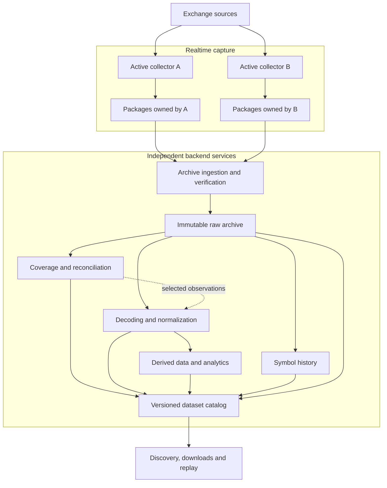

# Backend processing

Design direction, 8 November 2026. The realtime/backend separation and independent redundant
captures are agreed directions. The services below are proposed responsibilities, not deployed
capabilities. See the [MD capture reference design](md_capture_reference_design.md) for the current capture boundary
and the [Improvement proposal](improvement_proposal.md) for package ownership and precise rotation.

## Two independently operated systems

Realtime capture records observations with minimal work on the reception path. Backend services
have time to interpret, partition, reconcile, normalize and analyze them. A collector's output
is evidence for those services; it is not already a finished customer dataset.

The arrows describe available inputs, not one mandatory processing chain. Raw replay need not
wait for normalization; a parser correction can rerun normalization without recollecting data;
analytics can consume a chosen normalized release. Reconciliation may select raw observations
or compare decoded events, depending on the feed. Each job records its input identities,
parameters and software/schema versions. Jobs exchange durable references and can retry
independently; no backend acknowledgement is required for each live message.

## Responsibilities and handoffs

| Service | Responsibility and reason |
| --- | --- |
| Capture | Preserve source/session observations and package descriptors. Keep symbol splitting and market-data interpretation off the capture write path. |
| Archive ingestion | Discover eligible packages, verify inventories and hashes, upload idempotently, then register them durably. Acknowledge archive ownership before local deletion. |
| Recovery and inspection | Examine abandoned or damaged packages after ownership is resolved; preserve originals and publish recovered evidence with explicit limitations. |
| Coverage and reconciliation | Compare equivalent subscription scopes, report gaps/conflicts, and build reproducible selections from independent captures. |
| Decoding and normalization | Parse text, binary or structured protocols, partition by instrument/channel, and produce versioned common event types while retaining source references. |
| Symbol history | Build a time-indexed instrument directory from captured symbol responses and changes, independently of event-volume processing. |
| Derived data and delivery | Build books, candles, statistics and indexes; expose separately identified raw and derived products. |

A local spool with asynchronous archive upload is the proposed deployment baseline. Upload
failure must not stall the receiver directly, but disk capacity is finite: capacity alarms,
archive lag and an explicit exhaustion policy are required. Archive storage, job scheduling and
delivery protocols remain choices; a broker is not required merely to connect these services.

A completed package means its declared files were finalized according to the storage contract.
It does **not** prove that all expected exchange data was collected. Archive integrity,
subscription coverage and successful normalization are separate statuses in the catalog.

## Hot-hot capture and gap reconciliation

Both collectors subscribe actively to the required source scope. Each has a distinct process
identity and independently owned folders; they never append to a shared file or repair each
other's live output. Separate hosts, network paths or regions can reduce common failures, but
those choices must account for exchange connection limits and differences in observable feeds.

The backend reconciles a selected interval as follows:

1. Establish comparable exchange, channel, instrument, subscription options and session scope.
   Compare actual acknowledgements and observations, not configuration alone.
2. Identify events with exchange-specific IDs and sequence rules where available. Sequence
   numbers are comparable only within their defined domain; separate sessions need not share one.
3. Select usable coverage, retain duplicate observations and conflicts in the evidence, and
   publish a versioned view identifying the source record chosen for each result.
4. Report unresolved ranges and the strength of the evidence. If IDs or sequence guarantees are
   absent, label heuristic matching and unknown coverage rather than claiming completeness.

Payload equality can identify identical bytes but cannot prove that two messages are the same
market event. Local timestamps alone cannot establish identity or a universal event order.
Different message batching can also package the same market events differently. Preserve each
collector's receive timestamps and order; document any ordering chosen for a merged view.

Redundancy can fill a collector-specific gap only when another collector observed the missing
data and the feed's semantics allow it to be identified and placed. It cannot recover events
missed by every collector or never emitted by the source. A suitable snapshot can restore book
state with compatible subsequent deltas; it cannot recreate every missing trade or book update.
A reconciled view is therefore a distinct product from an individual collector's observation log.

## Operational evidence

Record subscription readiness, disconnects, sequence/checksum failures where supported, clock
quality, storage failures, package/archive lag and recovery actions. Silence alone is not a gap:
channels have different activity and heartbeat contracts. Report missing or uncertain intervals
per source and dataset, together with an incident history and later corrections.

Latency statistics need a defined measurement: exchange-to-local timestamp difference includes
clock error and source processing, so it is not automatically network latency. Preserve the
sampling points, clock assumptions and aggregation method with the statistic.

The next backend milestone is a small end-to-end demonstration: archive two independent runs,
introduce a known gap in one, reconcile a sequence-bearing feed, and expose both the original
observations and the derived coverage report. Product scope is developed separately in
[Market data services](md_services.md).
