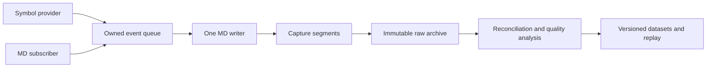

# Market-data capture design proposal

Status: capture proposals and the `md_logger_ai` storage contract, 7 November 2026.

The OKX app uses the simpler [md_logger](md_logger.md): a producer pending buffer, one shared queue, one
writer thread and one configured append-only file. The rotating implementation is retained as
`nom::md_logger_ai` in the independent `nom.md_logger_ai` module; the app imports
`nom.md_logger`. Sections below describing bounded queues, segments and metadata refer to
that implementation, not the current app's logger. Metadata remains a separate design review.

The objective is an auditable archive of exchange observations that can grow into a historical
market-data service. Capture should preserve enough evidence to rebuild datasets after parser,
normalization or reconciliation rules change. The first milestone is one exchange with a
well-understood recording and recovery contract.

## Three components

| Component | Owns | Emits |
| --- | --- | --- |
| Symbol provider | Catalog requests, refresh policy, response validation and catalog identity | Original textual catalog responses |
| MD subscriber | Connections, subscriptions, exchange heartbeats and reception | Original textual feed messages |
| MD logger | Ownership transfer, buffering, record framing and file output | Recorded text and storage status |

Both connectivity components use the same capture-event boundary. They can run in one app or
as separate apps, each with its own logger. A provider may additionally publish a parsed catalog
for subscription planning; that does not replace preserving its original response.

The logger has no symbol table, channel-to-file map, market-data JSON parser or symbol-dependent scheduling.
Every accepted event enters the same FIFO for that logger instance. Multiple symbols, catalog
messages, JSON acknowledgements and exchange error objects remain in the archive.
The adapter handles plain-text heartbeat replies outside the data stream.
Exchange interpretation stays in the adapters and downstream processors.



Configuration and operational diagnostics are application services. `json_config` loads and
validates settings before startup; `spd_logger` records state changes, failures and counters.
Full market-data payloads go through the MD logger.

## Event and time contract

A capture event contains exactly two values: a local receive timestamp and the received text.
The timestamp is stored as a signed decimal count of **microseconds since the Unix epoch**.
The OKX subscriber samples the local system clock at the start of its application receive
callback. This is not an exchange or NIC timestamp, and microsecond units do not imply
microsecond clock accuracy. Line order within each numbered segment preserves acceptance order,
even if the wall clock moves backward.

The first scope is JSON-object feeds in UTF-8. Preserve the received JSON except for replacing literal CR/LF with spaces. Do not rewrite
numbers, split arrays, remove fields or deduplicate. Record exchange
JSON acknowledgements and error responses too. OKX text `pong` remains in heartbeat handling. Local connection and
storage diagnostics go to the application log; they are not extra market-data records.
Subscription and format information belongs in each segment's metadata sidecar.

The app records reassembled application payloads, not TCP/TLS bytes or WebSocket frame
boundaries. `asio_comm` currently does not expose the WebSocket text/binary opcode. `md_logger_ai`
validates UTF-8; `md_logger` trusts the adapter. Valid UTF-8 alone cannot identify a binary protocol. Use this app only with
known textual endpoints. SBE and other binary feeds need a separately designed format and
explicit transport payload-type information; they are outside this implementation's scope.

A future symbol provider can use the same boundary. Request identity, HTTP status, response
headers and catalog context should be represented in metadata when that adapter is designed.
Clock synchronization quality and collector region also remain future provenance work.

There is no defensible universal order across independent collectors or exchange channels.
Offer individual observation streams and an explicitly defined merged dataset when needed.

## md_logger_ai implementation

`nom::md_logger_ai` uses one worker thread per logger. `append()` validates text, calculates its serialized size, and copies the borrowed
payload into an owned FIFO before returning. The worker replaces literal CR/LF with spaces and batches sequential writes with an open file descriptor. There are no per-message operational
logs, per-symbol queues or per-symbol files.

Acceptance is bounded by serialized bytes and record count, including records being written.
These are backlog limits, not a byte-perfect RSS limit: object overhead, allocator capacity and
the serialization buffer also consume memory. The first ingress path uses a mutex and owned
strings. It is a correctness baseline with bounded work proportional to payload size, not a
lock-free or allocation-free latency claim. Profile it before replacing it with preallocated
blocks or an SPSC queue. Multiple producers can append, but their acceptance order follows mutex
acquisition; a single I/O producer is the initial application topology.

`append()` reports accepted, full, too large, invalid text, stopped or failed. Callers can stop on
rejection and report failure. Operational error reporting remains independent of the capture queue. Pending-byte and accepted/written counters
make the outcome visible. Blocking indefinitely, silently discarding messages and allocating an
unbounded overflow queue are unsuitable defaults for this workflow.

The worker failure state is monitored even when no further market messages arrive. Shutdown
stops producers and cancels timers, drains transport callbacks, then drains and joins the writer.
Explicit `finish()` reports storage/publication failures; destructors provide cleanup but cannot
report success. Call `finish()` from one owner, after producers have stopped.

`finish()` has no deadline in this version. A stalled filesystem operation can delay both
writer progress and shutdown. This reinforces the preference for a local spool and the need
to define external supervision and crash recovery before deployment on remote storage.

### Text record format v1

Each `.txt` file is UTF-8 text with no header. Every record has this layout:

```text
<timestamp-microseconds><space><JSON-object><LF>
```

For example:

```text
1794000000123456 {"arg":{"channel":"trades","instId":"BTC-USDT"},"data":[{"px":"1"}]}
1794000000123457 {"event":"subscribe","arg":{"channel":"trades","instId":"BTC-USDT"}}
```

The separator is one ASCII space and the terminator is one LF byte. The JSON object is the
received message with each literal CR or LF byte replaced by one ASCII space. A CRLF pair
therefore becomes two spaces. Existing JSON escapes, other whitespace, field order and number
spelling are preserved. There is no extra quoting, custom escaping or JSON reserialization.
Split a record at its first space to recover the timestamp and stored JSON text.

Adapters supply JSON objects. The logger checks UTF-8 and object delimiters without parsing JSON
fields. CR/LF replacement keeps even a multiline message on one physical line; it has no effect
on ordinary single-line OKX messages. An escaped JSON newline (the two bytes backslash and `n`)
remains unchanged. Full JSON syntax validation belongs to the offline reader. OKX's plain-text
`pong` is handled by the heartbeat logic and is not a data record.

Size and backlog limits count the original JSON bytes, timestamp, space and LF. A record is
never divided between segments. Callers must handle rejected input explicitly.

The reader returns `received_us` and the stored JSON text in `data`, with a 256 MiB record
limit. It accepts files without metadata; `read_metadata()` separately validates the format
name/version of an `md_logger_ai` sidecar. Strict mode rejects an
unterminated line, invalid timestamp, UTF-8 or JSON, and any payload that is not a JSON object.
`--recover` stops at the first such failure and returns the complete prefix; it does not skip
ahead or modify evidence. This framing detects incomplete tails, not arbitrary corruption that
leaves valid JSON records. Content hashes and archive integrity verification remain follow-up work.

### Metadata sidecar

Every segment has a matching `<segment>.meta.json`, published before any data is written. The
writer supplies format name/version, encoding, field names, separators, payload representation, timestamp
units/epoch, run ID, opening time and both working/final data filenames. The application supplies
a JSON object once at logger construction; it appears under `capture`. That context can contain
the application name, exchange, market, transport, endpoint, timestamp sampling point and exact
subscription request. The current OKX app uses `md_logger` and does not generate this sidecar.

Metadata is immutable for that segment. It describes the requested subscription, not proof of
exchange acknowledgement or market-data completeness. A changed subscription/context requires
a new logger run in this implementation. Credentials must not be added to this context.

The sidecar is deliberately separate so the data file contains only timestamp/message lines and
can be inspected with ordinary text tools. An archive operation must retain the sidecar with its
data file. An orphan sidecar can remain after a failure before the first data write; a sidecar
alone is not a published data segment.

## File lifecycle, restarts and redundancy

A run reserves a directory such as `okx_spot-<start_utc_ns>-<random_id>/`. The random identifier
and exclusive directory creation protect simultaneous starts and restarts; timestamps alone
cannot guarantee uniqueness. Every run writes exclusively to its own directory.

The writer creates `00000000000000000000.<opened_utc_ns>.txt.partial` exclusively, writes complete
records, then publishes `00000000000000000000.txt` after successful synchronization and close.
The run identity remains in the parent path. Removing the temporary timestamp therefore does
not collapse independent writers onto one shared target filename.

Before creating that working data file, the writer exclusively creates a timestamped metadata
`.partial`, writes and synchronizes it, then publishes `<segment>.meta.json` without replacement
and synchronizes the directory. The data file is created only after that succeeds. At completion,
the final `.txt` name is the publication marker; the two files are not an atomic filesystem pair.
Recovery can use the sidecar while the corresponding data file is still `.partial`.

Size limits are applied between records. Age rollover uses steady time since segment creation,
not exchange timestamps or wall-clock buckets. Idle segments are also closed, with timer checks
at the configured flush interval. Empty runs create no segment. Graceful shutdown publishes the
last segment even if its normal rollover threshold has not been reached.

Publication uses Linux `renameat2(RENAME_NOREPLACE)` in the same directory. A collision is an
error; existing output is retained. Plain rename can replace an existing destination, and a
separate existence check would introduce a race. Unsupported no-replace operations fail rather
than silently weaken this contract. [Linux rename semantics](https://man7.org/linux/man-pages/man2/rename.2.html).

Partial writes advance within the same buffer and descriptor. Interrupted writes retry; a zero
write or other terminal write error fails the logger. A partly written batch is never reopened
and replayed from its beginning. Failure leaves the active file available for recovery. Errors
during synchronization, close or publication also cause failure. If rename succeeded but the
directory sync failed, the final name may already exist; failure does not imply a `.partial`
file must exist.

The first durability policy synchronizes segment data at rollover/shutdown, then the directory
after publication. Normal batching flushes data to the kernel, not necessarily stable storage.
Accepted, written and durably published are different states. A process crash can lose queued
records; a machine crash can lose unsynchronized segment data. Provision the output directory
hierarchy durably before operation. File synchronization alone does not persist directory
entries. [Linux fsync semantics](https://man7.org/linux/man-pages/man2/fsync.2.html).

My recommendation for deployment is a local persistent spool with asynchronous archive upload.
Network filesystem stalls then do not directly stall segment creation/publication. Local spool
capacity and upload lag still need explicit limits. Direct NFS writing needs deployment-specific
fault tests: availability, atomic visibility and crash durability are separate properties, and
remote errors can leave the outcome uncertain. The first implementation has only local-filesystem
validation; it does not claim NFS crash guarantees.

Recovery must establish that the producer is no longer writing. A stale mtime alone is not
proof of ownership loss. The initial reader is an offline inspection tool; it neither renames
nor repairs files. A future reconciler should operate on frozen copies or fenced runs, preserve
original evidence, and record which prefixes and segments contributed to each output.

## Growing into a historical-data service

Tardis documents a useful separation: its raw API delivers exchange-native messages with local
timestamps and disconnect markers, while derived daily datasets are partitioned by exchange,
data type and symbol. These are documented delivery contracts, not evidence of its internal
collector/storage implementation. [Raw API](https://docs.tardis.dev/api/http-api-reference),
[dataset API](https://docs.tardis.dev/downloadable-csv-files/api).

That separation fits this capture boundary: symbol partitioning belongs in a reproducible
downstream job. Tardis also documents preserved raw anomalies and duplicates, with normalization
and some deduplication applied to derived data. [Data semantics](https://docs.tardis.dev/faq/data).

I propose four independently testable stages:

1. **Capture:** exchange adapters and a local spool, with explicit loss/restart boundaries.
2. **Archive:** upload immutable segments, verify content hashes, and commit manifests before
   deleting local copies. Use independent compressed objects so a damaged object does not
   invalidate a whole day. Benchmark compression and segment size; do not put synchronous
   object-store requests on the reception path.
3. **Reconcile and derive:** preserve each collector's observations, select coverage with
   exchange-specific sequence rules, and build versioned normalized datasets and indexes.
   Deduplication based only on payload equality can erase legitimate repeated messages.
4. **Serve:** exchange/time/channel/symbol discovery, raw replay, bulk downloads and explicit
   quality metadata. Parquet is a candidate for research datasets; CSV and exchange-shaped
   replay support different clients. Neither format needs to dictate the ingestion format.

Two independent collectors can reduce collector-specific gaps. Keep both raw streams immutable.
Merge into a separate, versioned view using exchange event IDs and sequence semantics where
available, retaining provenance and conflicts. Exchange outages or information never emitted
by a public feed cannot be repaired by redundancy. Coverage is a measured property of each
stream/time interval, not a global "lossless" claim.

A useful product distinction is between **what a collector observed** and **best reconstructed
coverage**. A merged stream can contain events neither collector observed in that exact order.
Backtests should be able to choose the relevant interpretation rather than receive an invisible
mixture. Catalog history must also be time-indexed, including when a change was observed, to
avoid survivorship and look-ahead errors in symbol selection.

Quality metadata should include connection gaps, subscription success, useful-data freshness,
sequence/checksum failures, clock quality, pending bytes, storage failures and archive lag.
An acknowledgement or heartbeat establishes neither market activity nor complete coverage.
Different channels need different silence policies. Operators need a coverage view and incident
history before customers need another query API.

I would initially use files, an uploader and manifests. Add a broker when operational fan-out or
distributed ingestion requires it, with its acknowledgement and overload contracts specified.
A broker by itself does not prove that an exchange event reached the final archive.

Capacity planning should start with measured burst rates and retained bytes. For scale, 100,000
messages/s averaging 500 bytes is 50 MB/s, or 4.32 TB/day before framing, replication and
compression. Network egress, redundant collection and derived datasets can dominate costs.
Set retention tiers and recovery objectives before expanding exchange coverage.

## Delivered first slice and next decisions

The first slice is `okx_md_capture`: JSON configuration, a Spot WebSocket subscriber and
`md_logger`. It appends incoming textual application messages to one configured file, with a
text heartbeat deadline, signal handling and explicit writer shutdown. Symbols are configured directly.
The symbol provider uses the same proposed boundary but is not implemented in this slice.

Outstanding production work includes subscription acknowledgement/error interpretation,
automatic reconnect and gap lifecycle, useful-data freshness, catalog refresh, richer collector/clock provenance,
archive upload and reconciliation. Snapshot acquisition/reconstruction remains a separate
design discussion. The current app does not reconstruct books or assert market-data readiness.

Before deploying broadly, decide and validate:

- Maximum acceptable queueing delay, overflow policy and an optional periodic durability sync.
- Local-spool versus direct network storage, disk-full behavior and recovery ownership/fencing.
- Text format stability, compression, archive integrity hashes and portable reader commitments.
- A separate binary capture contract and transport opcode information before adding SBE feeds.
- Catalog/version metadata and provenance for redundant collection and derived datasets.
- Throughput and callback latency under burst load, slow disks and rotation; allocations and
  mutex contention should be measured before choosing a more specialized queue.
- Fault tests for abrupt process termination, host loss, ambiguous network storage failures,
  independent collectors, clock adjustments and archive-upload retries.

The combined `md_logger`, `md_logger_ai` and app tests cover exact JSON preservation, single-line framing, UTF-8 checks, microsecond timestamps, queue limits,
size rollover, metadata and publication collisions, writer errors, interrupted/short/zero writes, local TLS reception,
heartbeat expiry, configuration, time rollover, signals and prefix recovery. They do not
establish sustained production capacity or distributed-storage durability.
