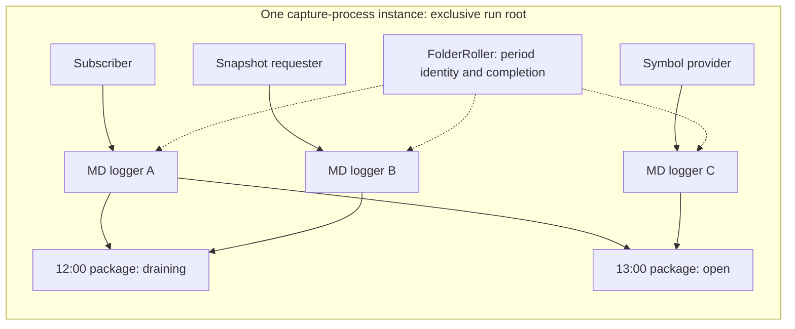
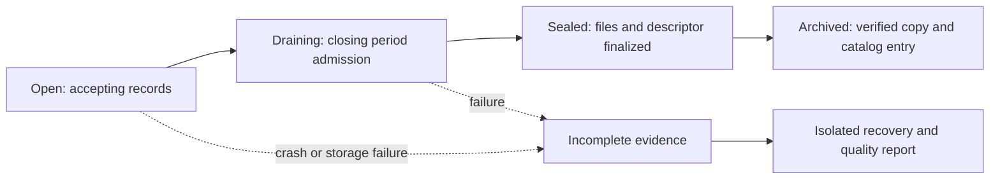

# Improvement proposal

AI-generated : to be reviewed

Design checkpoint, 8 November 2026. The [MD capture reference design](md_capture_reference_design.md) describes the
current recorder. This proposal records the next storage and source contracts, without selecting
class APIs or the placement of shared application services.

## Agreed direction

- Rotate by **calendar hour or calendar day**, precisely at record boundaries. Do not add
  file-size or record-count rotation. Batching and backlog limits remain separate concerns.
- Use folders as data packages, containing recorded data and descriptors for every file.
  Symbol information belongs here too; statistics and analytics may be added later.
- Give each capture-process instance exclusive ownership of its output. Several source-specific
  MD loggers in that process share the appropriate period folder, each owning its own files.
- Preserve source streams without runtime symbol/channel splitting. Perform splitting, cleaning,
  reconciliation and normalization in backend services.
- Support continuous subscribers, periodic requesters and one-off acquisitions. Extend the
  recording contract for binary protocols and session-oriented feeds rather than forcing JSON.

The sections below propose how to realize these decisions. Names, schema details, timestamp
basis, durability policy and late-data behavior still need agreement.

## Package identity and contents

Proposed hierarchy: one **run root per process incarnation**, containing hour/day package folders.
A restart reserves a new root, even within the same period. Root creation must establish unique
ownership; a timestamp, reusable pod name or existence check alone is insufficient. Independently
running collectors never append to the same paths.

Illustrative names only:

```text
capture-<unique-run-id>/
  2026-11-08T12Z/
    descriptor.json
    stream-a.data
    snapshots-a.data
    symbols.data
  2026-11-08T13Z/
    ...
```

The descriptor identifies the package's owner and period and describes **each file**: source,
connection/request session, format and version, timestamp meaning, payload representation and
completion status. Each file's description may be an entry in one package document or a separate
sidecar; that choice is open. This is ordinary per-file metadata, not a separate kind of record.
Keep credentials out of it. Distinguish requested subscriptions from acknowledged subscriptions
and observed coverage. Record build/configuration provenance without embedding secrets.
Session/context changes within a period need an explicit representation: session spans or
separately described files in the same folder. This does not add another package rotation trigger.

Start with one data file and its description; additional sources add their own described files.
Symbol data should preserve original responses and their observation times. Decide whether each
package embeds the applicable catalog baseline and changes or references an immutable version;
references must remain resolvable for the package's retention lifetime.

Package, record-format and descriptor-schema versions have different meanings. Reserve extension
points for statistics, including clock/latency measurement definitions, and for analytics.
Proposed rule: freeze capture contents when the package is sealed. Later analytics are versioned
artifacts referring to it; including them in a distributed package creates a new package revision.

## Exact time partitioning and FolderRoller

Proposed time basis: **UTC calendar periods using local receive timestamps**. This avoids parsing
exchange payloads in the recorder. Confirm this before implementation. Periods are half-open:
`[start, end)`; a record timestamped exactly 13:00 belongs to the 13:00 hour. A batch containing
12:59:59.999999 and 13:00:00.000000 must be split into different packages, regardless of when it
is flushed. Never assign a whole batch using its first record or the worker's current time.

Precision applies to the chosen timestamp of a complete capture record. Exchange events inside
one payload can span exchange-time periods; splitting those events is backend work. Preserve
source order and record identity even if timestamps move backward. Define how cross-file capture
order is recovered, for example through source/session record ordinals in the format or an index.
This capture-order identity is separate from exchange sequence numbers; its representation is open.



FolderRoller is a coordinator, not another market-data writer. It registers sources, resolves
period identity, reserves file ownership and tracks completion. Writers progress independently;
a slow writer can drain the previous package while another writes the next. A single mutable
"current directory" cannot provide correct routing for queued data.

A timer can request period closure but cannot prove it. Completion requires acknowledgements
covering every participating source's pending, queued and in-flight records for that period.
Idle sources must participate without waiting for another market message. Define admission and
completion for dynamically created one-off sources. No writer or late registration may modify
a sealed package.

Clock regressions and records arriving at the writer after their period was sealed need an
explicit policy. Proposals are controlled failure or a separately identified late-data package
for the original period. Never silently place such records into the current period. The close
protocol must establish that sources cannot submit further ordinary records for the old period;
an arbitrary wall-clock grace period alone is not that guarantee.

## Sources, snapshots and protocol context

Periodic snapshot requests use their own requester/logger beside the subscription logger.
A one-off acquisition can create, register, drain and stop its requester/logger independently of
the rest of the process. Completion of that source does not complete the whole package.

Keep request identity, request/response times, status and the related subscription-session ID.
A request before a boundary may return after it; record the response in its own receive-time
period and preserve the cross-period relationship. A storage roll must not restart subscriptions
or trigger unnecessary snapshot requests. Snapshot frequency is an exchange-specific acquisition
policy; downstream reconstruction must verify snapshot/update sequence compatibility.

Select a recording format per source. Text retains the readable timestamp/message layout.
Binary recording needs unambiguous framing, length/version information and incomplete-tail
rules. FIX and similar protocols need preserved message boundaries and relevant session,
sequence/reset/retransmission context; receive time plus payload is not a complete universal
contract. Do not rewrite payload sequence numbers. Avoid converting binary payloads to text just
to fit the first format. Exact framing and context representation remain open.

## Publication, recovery and file handles

Proposed lifecycle:



Publish a package completion record only after its files and descriptors meet the selected
synchronization policy. Partial files/descriptors and failed writers must remain distinguishable
from a sealed package. **Sealed does not mean gap-free market data.** An intentionally short
capture can be finalized while reporting only its observed interval within the calendar period.
The exact completion marker, no-replacement publication mechanism and empty-period policy are open.

Accepted, written, synchronized, sealed and archived are separate states. The existing `stop()`
already drains, joins and reports errors; extend that behavior to package coordination rather
than introduce a second finishing API by default. A write or publication error must not become
successful shutdown. Recovery operates only after excluding active writers, preserves original
files and records the valid recovered prefix and any uncertainty. Never restart by blindly
appending to an interrupted run.

Reconsider persistent descriptors **after** ownership isolation. Keeping each file open while
its period is active is a candidate optimization; repeated open/write/close is not an ownership
or durability guarantee. Linux documents possible NFS corruption when several processes append
to one file. Separate run paths address that collision, not all network-storage failures.
[Linux open semantics](https://man7.org/linux/man-pages/man2/open.2.html).

A successful close or rename alone is not the durability contract; file and directory
synchronization have distinct roles. Validate the actual storage/mount deployment, including
ambiguous write outcomes and blocked I/O. A local persistent spool with asynchronous upload is
a proposal, with its own capacity and recovery obligations.
[Linux synchronization semantics](https://man7.org/linux/man-pages/man2/fsync.2.html).

## Resume plan

Proceed in small checkpoints; do not expand a partially agreed format into a permanent contract.

| Checkpoint | Decision or evidence needed before proceeding |
| --- | --- |
| 1. Package contract | Agree contents, run/source/session identities, time basis, hour/day boundaries and descriptor responsibilities |
| 2. Ownership and registration | Simultaneous starts and restarts cannot share writable paths; multiple loggers and one-off sources register predictably |
| 3. Period routing and draining | Test boundary minus/plus one microsecond, mixed batches, delayed writers, idle pending data and clock regressions; no adjacent-period record leakage |
| 4. Publication and recovery | Agree durability and close policy; test interrupted data/descriptor writes, partial writes, publication collisions, storage failure and owner loss |
| 5. Source context and formats | Specify symbol history, snapshot/session links and text/binary/FIX record contracts with readers and cross-period examples |
| 6. Backend handoff | Archive and catalog packages with integrity checks; produce reproducible coverage/reconciliation results from independent captures |
| 7. Operational qualification | Set backlog/overflow and storage-capacity policy; measure receive latency and throughput under bursts, slow storage, rollover and restart faults |

Backlog limits constrain resource use, not file rotation. Define overflow behavior explicitly;
no silent loss and no assumption that in-memory acceptance survives a crash. Detailed service
and product responsibilities are in [Backend processing](backend_processing.md) and [Market data services](md_services.md).
