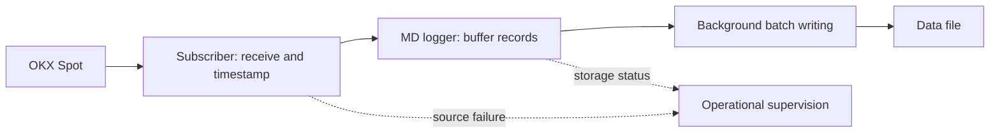

# MD capture reference design

The doc describes the current state of MD capture for OKX and general approaches which will be applied to all other exchanges.

Please also see:
1. Future work in [Improvement proposal](improvement_proposal.md)
2. [Backend processing](backend_processing.md) - clean raw data, separate symbols streams, combine data channels, normalize, reformat, fill in gaps
3. [Market data services](md_services.md) covers the customer-facing MD directory (by exchange, asset class, symbol, date, granularity, type) and data delivery method.

## Purpose and scope

Capture original market data updates from exchanges, with enough context to interpret it later. MD capture preserves
observations for replay, investigation and reproducible dataset construction. It does not split
symbols, normalize market events, reconstruct books or remove duplicates while recording.

The expected scope is around **20 different data sources**, with room for future extension. An exchange may provide differnet market data access points for differnet instrument types. Even protocols to deliver market data may differ so **20 different data sources** doesn't mean "20 different exchanges" for this reason.
The current reference application is OKX Spot.

## Componnets and their responsibilities

| Role | Responsibility | Reason for the boundary |
| --- | --- | --- |
| MD subscriber | Maintain a subscription and deliver received messages with capture time | Exchange connection/session behavior belongs to the source adapter |
| Symbol provider | Obtain instrument definitions and their changes | Recorded prices and quantities need the relevant instrument context |
| MD logger | Own received payloads, buffer them and write one ordered source stream | Storage work should not require symbol interpretation on the receive path |

A source stream is one independently acquired subscription or request stream; one exchange
can supply several. One capture process may own several such streams and loggers. **Each source
stream has its own MD logger**; a multiplexed subscription remains one stream even when it
contains many symbols or channels.
A separately subscribed stream has its own logger. A connection session identifies a continuous
subscription; a file period is a storage boundary and does not start or end that session.

Folder packaging, requesters and symbol acquisition are agreed directions, not implemented
features of the current reference. The descriptor name and schema remain open.

## Current reference flow



The receive path transfers owned data to the logger; filesystem work happens in the background.
The logger does not inspect payload fields to select a destination. Symbol partitioning,
validation, cleaning and normalization belong to independently scheduled backend services.
Operational diagnostics are separate from market-data records.

### Recorded observations

The current text format is:

```text
<local-receive-timestamp-in-microseconds> <received-JSON-object><LF>
```

Time is measured since the Unix epoch, sampled at application receive-callback entry. It is
neither an exchange timestamp nor a hardware network timestamp; microsecond units do not
promise microsecond accuracy. Each complete application message becomes one record. Literal
CR/LF bytes in the payload become spaces; existing JSON escapes, field order and number spelling
remain unchanged. This is not a byte-for-byte archive of multiline payloads or network frames.

The OKX adapter handles plain `pong` separately and records other received payloads, including
JSON subscription acknowledgements and error responses. Recording these does not mean the app
has validated subscription success. The logger trusts the adapter's textual input.

Within one logger, record order preserves the source's acceptance order. Independent sources
and collectors have no universal order; their observations must remain identifiable. A later
reconciled dataset defines its own ordering and provenance.

### Completion and failure

Acceptance means the logger owns a record in memory, not that storage has committed it.
Shutdown first stops the producer, then drains and joins its writer. The existing `stop()`
already performs finishing and reports recorded writer failure; `error()` provides the reason.
Destruction provides cleanup but is not a positive recording-success report.

Writes retain the unwritten suffix after a short write. Exhausted storage retries become a
recording failure. Successful writes and closes do not establish power-loss durability.
Future package completion must extend these guarantees across all participating loggers.

## Current limitations

| Area | Current reference and consequence |
| --- | --- |
| Packaging | One append file; no process-owned package folders, descriptors or calendar rotation |
| Queueing | One serialized producer; unbounded backlog. Batching thresholds are not capacity limits |
| Idle pending data | Contended records enter a pending buffer, transferred on a later successful enqueue or `stop()`; the flush period alone does not bound their residence time |
| Storage | Each batch opens, appends and closes the file. No explicit durability sync or protection against another instance using that path |
| Recovery | An inspection reader can return the valid text prefix; no managed recovery, upload or package-publication service exists |
| Protocol context | Only receive time and payload are recorded. Binary framing, FIX session context, requests, symbols and machine-readable lifecycle evidence need further design |
| Feed health | No complete readiness, automatic reconnect, gap-accounting or market-data freshness contract yet |
| Validation | Local storage and TLS tests exist; sustained production performance, crash behavior and target network-storage guarantees are unproven |

The [MD logger guide](md_logger.md) describes the implementation API. It is separate from this
design so changes to configuration plumbing, runtime composition or service-layer placement do
not redefine the capture contract.
