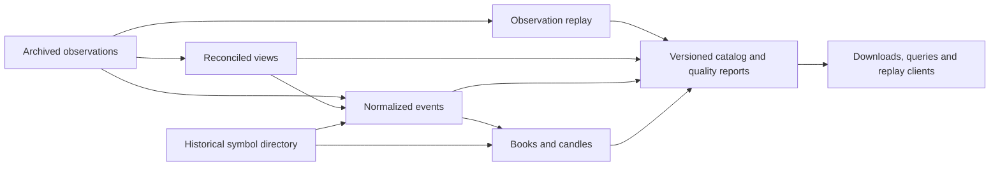

# Market data services

Exploratory proposal, 8 November 2026. The goal is a service whose product is useful, inspectable
market data. Delivery formats, retention periods, commercial terms and service promises are not
yet selected. [Backend processing](backend_processing.md) separates this work from realtime capture.

As a product reference, Tardis documents exchange-native historical replay and normalized
downloadable datasets. These are useful distinct customer contracts; they do not establish how
its internal collectors are implemented. [Tardis access methods](https://docs.tardis.dev/api/quickstart).

## Product families

| Product | Customer value | Contract to define |
| --- | --- | --- |
| Captured observations | Audit, custom decoding and replay of what one collector received | Source/session identity, capture framing and declared transformations, original ordering and known gaps. |
| Reconciled observations | Better coverage from redundant captures | Selection policy, contributing records, unresolved gaps/conflicts and release version. |
| Normalized events | Cross-exchange research without a parser for every feed | Typed schemas, units, precision, timestamp semantics and exchange-specific extensions. |
| Derived datasets | Books, candles, quotes and other analysis-ready views | Inputs, reconstruction/aggregation rules, quality conditions and correction policy. |

A package is a capture and recovery unit. Customer partitioning is a separate decision:
backend jobs can create exchange/instrument/event-type/time datasets from multiplexed captures.
Customers should be able to distinguish a collector's observed timeline from a reconciled view;
combining observations must not silently rewrite the experience of an individual receiver.

## Unified semantics before a delivery format

Propose a common envelope containing event type, stable instrument identity, source identity,
exchange event time when provided, local receive time and provenance. Use versioned schemas for
trades, book updates, snapshots and other event types, rather than one flat universal record.
Keep unknown fields unknown; do not substitute a receive time for an exchange time without
explicitly identifying the substitution. Preserve exchange-specific details when normalization
cannot express them without loss.

Capture codecs remain source-specific. Text, binary/SBE and FIX records need their original
payload plus the framing/schema and session context necessary for decoding. A common normalized
format does not require converting binary capture into JSON. Preserve exact numeric precision,
units and contract multipliers; names such as “amount” are insufficient without their meaning.

CSV is a candidate for simple interchange, a columnar format for analytical scans, and an
exchange-shaped representation for observation replay. Select formats with measured size,
decode cost and client needs. Version schemas and transformation rules independently of the
package descriptor. Publish immutable dataset releases with input and software provenance;
corrections create new releases with a changelog rather than silently altering previous results.

## Aggregation is an explicit product

Candles should supplement retained tick-level evidence, not replace it by default. Define:

- Input event type and eligible trades, duplicate handling and correction rules.
- Event-time or receive-time basis, UTC interval boundaries, and deterministic tie ordering.
- Price precision, volume units, trade count and any VWAP definition.
- Treatment of empty intervals, late events and known gaps; “no trades” and “missing data” differ.
- Publication delay and revision policy, with references to the exact input dataset release.

Order-book products similarly need snapshot/delta alignment, depth and checksum policy, reset
rules and explicit invalid intervals. Exchange-supplied quotes, reconstructed quotes and sampled
book snapshots are different datasets even when their fields look alike. Tardis also documents
these distinctions among its dataset types. [Dataset semantics](https://docs.tardis.dev/downloadable-csv-files/data-types).

## Historical symbol directory

Keep native exchange identifiers and stable internal identities, including instrument lifecycle,
base/quote currencies, tick/lot sizes, contract definitions, expiry and aliases. Distinguish
exchange-reported effective times from when the service observed a change. Retain delisted
instruments and identifier reuse; historical selection must not depend only on today's catalog.
Metadata availability, instrument listing and actual market-data coverage are separate facts.

Symbol responses can be captured within packages, while the backend builds a directory across
packages. Derived datasets reference the directory version used to interpret their inputs.
Unknown historical changes remain unknown. This is a useful product in its own right: Tardis
provides instrument metadata and explicitly qualifies the completeness of historical changes.
[Instrument metadata](https://docs.tardis.dev/api/instruments-metadata-api).

## Retention and distribution

| Stored material | Proposed retention rule; durations remain open |
| --- | --- |
| Working/local packages | Retain until verified archive ownership and recovery requirements permit removal; reserve capacity for upload interruptions. |
| Raw captures and symbol history | Set an explicit retention commitment that supports audit and future reprocessing; preserve required provenance and descriptor/schema definitions with the data. |
| Reconciled and derived releases | Retain reproducible published versions for the promised term; cached exports can have shorter lives if their exact inputs remain available. |

Redundant raw copies have a cost, but deleting them after reconciliation removes some ability to
audit selection or improve it later. Decide that tradeoff explicitly. Compression and storage
tiers can reduce cost; validate random-access and recovery behavior before choosing layouts.

Begin delivery with dataset discovery, coverage/incident metadata and resumable bulk downloads
with manifests and checksums. Add filtered queries or replay when customer demand justifies
their indexing, compute and support cost. Specify publication lag, correction notices, access
entitlements and download limits separately from capture cadence. No public API protocol is chosen.

## Small-business starting point

Expected capture scope is roughly 20 different data sources, with possible future extension.
Connectivity breadth alone does not establish equivalent recorded history or quality across
them. Define commercial coverage by source, channel and instrument, backed by availability
and quality evidence. Validate customer demand and redistribution permissions for that scope.
Measure redundant collection, storage, normalization/reprocessing, egress and operator support
costs together. More retained data creates both an asset and an ongoing service obligation.

The first commercial decision is which customer problem to serve: auditable raw replay,
reliable normalized research data, or a small derived product such as candles. Set measurable
coverage, freshness and retention commitments for that scope; avoid a universal “lossless” claim.
An operating coverage report and documented limitations are part of the product, not merely
internal monitoring. These choices can be revisited without changing the core capture boundary.
